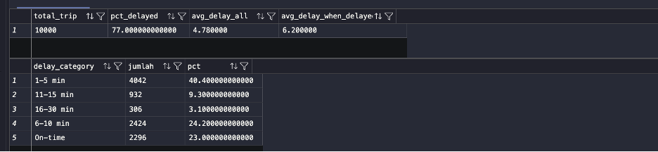
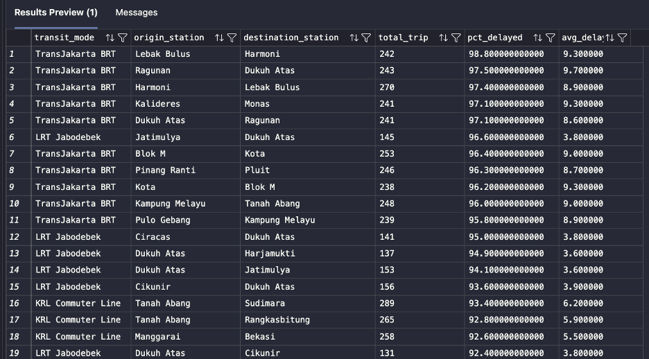
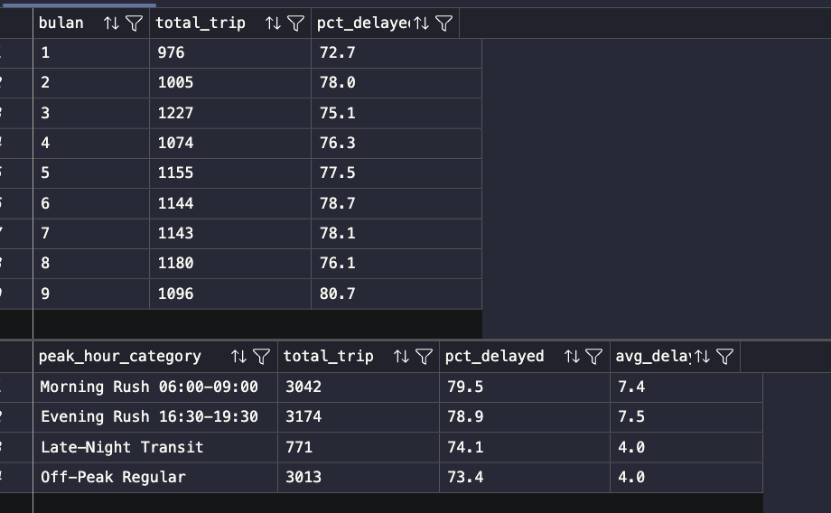
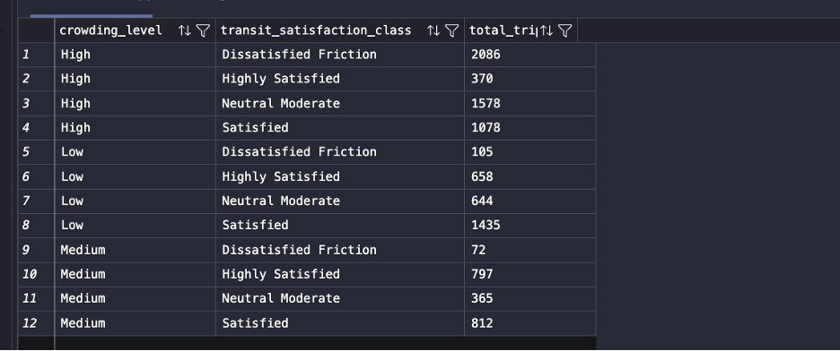
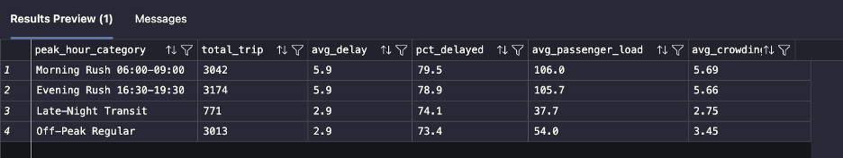
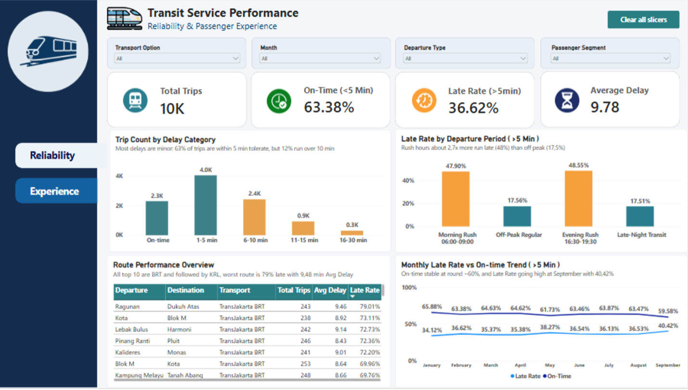
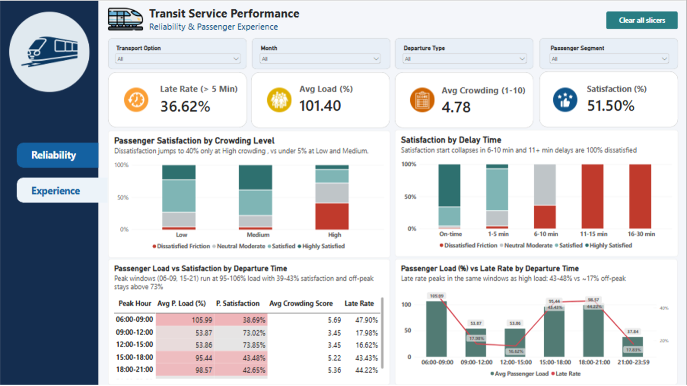

# Public Transit Reliability & Passenger Satisfaction Analysis

An end-to-end analysis of 10K transit trips across multiple transport modes in Indonesia (including TransJakarta BRT and KRL). It connects **service reliability** (how often and how badly trips run late) with **passenger experience** (how delays and crowding shape satisfaction), using SQL Server for analysis and Power BI for dashboards.

---

## Table of Contents

1. [Business Problem](#business-problem)
2. [Dataset & Tools](#dataset--tools)
3. [Project Objectives](#project-objectives)
4. [Business Questions](#business-questions)
5. [Methodology](#methodology)
6. [SQL Analysis](#sql-analysis)
7. [Power BI Dashboard](#power-bi-dashboard)
8. [Key Findings](#key-findings)
9. [Recommendations](#recommendations)
10. [Project Structure](#project-structure)
11. [Limitations](#limitations)

---

## Business Problem

Public transportation is the backbone of urban mobility in Indonesia's major cities, but its value depends on whether passengers can rely on it. Chronic delays and overcrowded vehicles during peak hours reduce the appeal of public transit and push commuters back to private vehicles, worsening congestion and emissions.

Rather than treating service performance and passenger experience as separate topics, this analysis connects them. It helps operators and transport authorities see **where service quality breaks down** and **what it costs in passenger satisfaction**, so scheduling and peak-hour capacity improvements can be prioritized where they matter most.

## Dataset & Tools

**Data:** 10K transit trip records across multiple transport modes. Columns cover origin and destination stations, departure period, delay minutes, passenger load factor, crowding score, passenger segment, and satisfaction class.

| Tool | Usage |
| --- | --- |
| Docker | Runs SQL Server |
| SQL Server + VS Code (mssql extension) | Data import, cleaning, feature engineering, analysis queries |
| Power BI Desktop (via Parallels on Mac) | Dashboard, connected to SQL Server using the Mac IP + MSSQL port |

## Project Objectives

- Evaluate service reliability: on-time rate, late rate, average delay, delay category distribution, and routes with the worst on-time performance.
- Analyze delay patterns across operating periods (departure period and month) to find when reliability is weakest.
- Assess whether delay duration and crowding level are associated with passenger satisfaction.
- Compare passenger load, crowding score, satisfaction, and late rate across departure time windows.
- Formulate actionable recommendations on scheduling and peak-hour capacity.

## Business Questions

1. How reliable is public transportation service?
2. Which routes experience the most delays, and which transport modes do they belong to?
3. How do delays vary across operating periods (rush hour vs off-peak, month to month)?
4. Is passenger crowding associated with passenger satisfaction?
5. How does delay duration affect passenger satisfaction, and where is the tolerance threshold?
6. How do delays, crowding, and satisfaction vary across departure time windows?

---

## Methodology

1. Run SQL Server in Docker, connect from VS Code, create the database, and import the data with adjusted data types.
2. Copy the raw `transport` table into `transport_analyse`, so the original data stays untouched.
3. Drop columns not used in the analysis.
4. Standardize the scale of score and index columns.
5. Create delay flags and delay categories in SQL.
6. Answer each business question with SQL queries.
7. Build the Power BI dashboard (2 pages) with DAX measures and helper columns.

## SQL Analysis

### 1. Data preparation

```sql
-- Preview 20 rows
SELECT TOP 20 * FROM transport;

-- Copy data and structure into a working table
SELECT *
INTO dbo.transport_analyse
FROM dbo.transport;

SELECT TOP 20 * FROM transport_analyse;

-- Drop unused columns
ALTER TABLE transport_analyse
DROP COLUMN payment_method,
            carbon_emission_savings_kg,
            arrival_time,
            cot_transit_logistics_rationale,
            confidence_score;

-- Standardize score and index ranges
UPDATE transport_analyse
SET passenger_load_factor_pct      = passenger_load_factor_pct / 10.0,
    transit_efficiency_index       = transit_efficiency_index / 100.0,
    crowding_discomfort_score      = crowding_discomfort_score / 100.0,
    fare_to_speed_ratio            = fare_to_speed_ratio / 10.0,
    first_last_mile_friction_index = first_last_mile_friction_index / 10.0;
```

### 2. Delay flags and categories

A delay of 1-5 minutes is treated as normal. A trip counts as **significantly late** only when delay is **more than 5 minutes** (see Finding 8 for why).

```sql
ALTER TABLE transport_analyse
ADD is_delayed TINYINT,
    is_late_significant TINYINT,
    delay_category VARCHAR(15);

UPDATE transport_analyse
SET is_delayed = CASE WHEN delay_minutes > 0 THEN 1 ELSE 0 END,
    is_late_significant = CASE WHEN delay_minutes > 5 THEN 1 ELSE 0 END,
    delay_category = CASE
        WHEN delay_minutes = 0   THEN 'On-time'
        WHEN delay_minutes <= 5  THEN '1-5 min'
        WHEN delay_minutes <= 10 THEN '6-10 min'
        WHEN delay_minutes <= 15 THEN '11-15 min'
        ELSE                          '16-30 min'
    END;
```

### 3. Q1: How reliable is the service?

```sql
-- Delay summary
SELECT
    COUNT(*) AS total_trip,
    ROUND(100.0 * SUM(is_delayed) / COUNT(*), 1) AS pct_delayed,
    ROUND(AVG(delay_minutes * 1.0), 2) AS avg_delay_all,
    ROUND(AVG(CASE WHEN is_delayed = 1
        THEN delay_minutes * 1.0 END), 2) AS avg_delay_when_delayed
FROM transport_analyse;

-- Trips by delay category
SELECT delay_category,
       COUNT(*) AS jumlah,
       ROUND(100.0 * COUNT(*) / SUM(COUNT(*)) OVER (), 1) AS pct
FROM transport_analyse
GROUP BY delay_category
ORDER BY delay_category;
```



### 4. Q2: Which routes are late most often?

Only routes with at least 10 trips are included, to avoid small-sample noise.

```sql
SELECT
    transit_mode,
    origin_station,
    destination_station,
    COUNT(*) AS total_trip,
    ROUND(100.0 * SUM(is_delayed) / COUNT(*), 1) AS pct_delayed,
    ROUND(AVG(CASE WHEN is_delayed = 1
        THEN delay_minutes * 1.0 END), 1) AS avg_delay
FROM transport_analyse
GROUP BY transit_mode, origin_station, destination_station
HAVING COUNT(*) >= 10
ORDER BY pct_delayed DESC;
```



### 5. Q3: Delays by peak hour category

```sql
SELECT
    peak_hour_category,
    COUNT(*) AS total_trip,
    CAST(100.0 * SUM(is_delayed) / COUNT(*) AS DECIMAL(5,1)) AS pct_delayed,
    CAST(AVG(CASE WHEN is_delayed = 1
        THEN delay_minutes * 1.0 END) AS DECIMAL(5,1)) AS avg_delay
FROM transport_analyse
GROUP BY peak_hour_category
ORDER BY pct_delayed DESC;
```



### 6. Q4: Crowding vs satisfaction

Crowding level is based on passenger load: **Low** (<60), **Medium** (60-90), **High** (90 and above). These cut-offs are analytical decisions.

```sql
SELECT
    CASE
        WHEN passenger_load_factor_pct < 60 THEN 'Low'
        WHEN passenger_load_factor_pct < 90 THEN 'Medium'
        ELSE 'High'
    END AS crowding_level,
    transit_satisfaction_class,
    COUNT(*) AS total_trip
FROM transport_analyse
GROUP BY
    CASE
        WHEN passenger_load_factor_pct < 60 THEN 'Low'
        WHEN passenger_load_factor_pct < 90 THEN 'Medium'
        ELSE 'High'
    END,
    transit_satisfaction_class
ORDER BY crowding_level, transit_satisfaction_class;
```



### 7. Q5/Q6: Delay and crowding by time period

```sql
SELECT
    peak_hour_category,
    COUNT(*) AS total_trip,
    CAST(AVG(delay_minutes * 1.0) AS DECIMAL(5,1)) AS avg_delay,
    CAST(100.0 * SUM(is_delayed) / COUNT(*) AS DECIMAL(5,1)) AS pct_delayed,
    CAST(AVG(passenger_load_factor_pct * 1.0) AS DECIMAL(5,1)) AS avg_passenger_load,
    CAST(AVG(crowding_discomfort_score * 1.0) AS DECIMAL(5,2)) AS avg_crowding
FROM transport_analyse
GROUP BY peak_hour_category
ORDER BY pct_delayed DESC;
```



---

## Power BI Dashboard

Power BI connects directly to the `transport_analyse` table in SQL Server (`T` in the formulas below).

### DAX measures

| Measure | Formula | Purpose |
| --- | --- | --- |
| On-Time Rate | `DIVIDE(CALCULATE(COUNTROWS(T), T[is_late_significant]=0), COUNTROWS(T))` | % of trips with delay ≤5 min |
| Late Rate | `DIVIDE(SUM(T[is_late_significant]), COUNTROWS(T))` | % of trips with delay >5 min |
| Avg Passenger Load | `AVERAGE(T[passenger_load_factor_pct])` | Average load (%); above 100 means over capacity |
| Avg Crowding | `AVERAGE(T[crowding_discomfort_score])` | Average crowding score (1-10) |
| Satisfaction % | `DIVIDE(CALCULATE(COUNTROWS(T), T[transit_satisfaction_class] IN {"Satisfied","Highly Satisfied"}), COUNTROWS(T))` | % of Satisfied + Highly Satisfied trips |

### Helper columns

| Column | Logic | Purpose |
| --- | --- | --- |
| Crowding Level | Load <60 Low, 60-90 Medium, ≥90 High | X-axis of crowding vs satisfaction chart |
| bucket_hour | 3-hour window from `departure_time` | X-axis of table and combo chart on Page 2 |
| Sort columns | Order numbers 1-n (Crowding Sort, Satisfaction Sort, delay_category_sort, bucket_hour sort, peak_hour_sort) | Orders categories in charts and slicers |

Columns from SQL: `is_late_significant`, `delay_category`, and the rescaled score columns.

### Page 1: Reliability

Measures delays across routes, modes, periods, and months.



### Page 2: Experience

Measures satisfaction against delay, crowding, and departure time window.



---

## Key Findings

### Reliability

1. **One in three trips is truly late.** On-time rate is 63.4%, late rate 36.6%, and a late trip runs 9.78 minutes on average. Delays of 1-5 minutes are treated as normal because they do not reduce satisfaction.
2. **Severe delays are few but damaging.** Only ~12% of trips are delayed more than 10 minutes, yet this group hurts satisfaction the most.
3. **Rush hour is ~2.7x more often late.** Morning 47.9% and Evening 48.6%, vs Off-Peak 17.6% and Late-Night 17.5%. The problem is concentrated in two periods.
4. **The worst routes are dominated by BRT.** Ragunan → Dukuh Atas 79.0%, Kota → Blok M 73.1%, Lebak Bulus → Harmoni 72.7%. Average delay is close to the overall average, so what sets these routes apart is how *often* they are late, not how severe.
5. **Modes on shared roads are late most often.** BRT 71.1%, KRL 42.9%, LRT 15.3%, MRT and Whoosh 0%. Separate right-of-way is only a hypothesis, because the data has no such variable.
6. **Stable trend, with a rise in September.** Late rate is 34-38% from January to August, then 40.4% in September. One month is not enough to call it a trend.

### Experience

7. **Dissatisfaction jumps only at High crowding.** ~40% at High vs <5% at Low and Medium, so comfort holds up to ~90% of capacity.
8. **The delay threshold is 5 minutes.** At 6-10 minutes ~36% are dissatisfied, and at 11+ minutes 100%. This supports the 5-minute cut-off used for Late Rate.
9. **Two distinct service conditions.** Peak windows (06-09, 15-21) show load of 95-106%, satisfaction of 39-43%, and late rate of 43-48%. Off-peak windows show load of 38-54%, satisfaction of ~73%, and late rate of 16-18%. Delay, crowding, and satisfaction get worse together, with 06-09 being the worst.

## Recommendations

| # | Recommendation | Rationale | Basis |
| --- | --- | --- | --- |
| 1 | Review added capacity or frequency at 06:00-09:00 and 15:00-21:00, prioritizing 06:00-09:00 | Load is near or above capacity (95-106%), satisfaction is 39-43%, late rate is 43-48%. The 06-09 window is worst (load 106%, late 47.9%) | Findings 3, 7, 9 |
| 2 | Fix BRT schedules on the 3 worst corridors, including the scheduled-duration buffer | Late rate is 73-79% with ~9 minutes average delay, which suggests schedules do not match road conditions | Findings 4, 5 |
| 3 | Use 5 minutes as the service standard and aim to reduce trips delayed >10 minutes | Delays ≤5 min do not hurt satisfaction, while 11+ min is 100% dissatisfied | Findings 2, 8 |
| 4 | Study dedicated lanes or tracks for BRT and KRL | MRT and Whoosh are 0% late vs BRT 71.1% and KRL 42.9%. Other factors may also play a role, so it needs further study | Finding 5 |
| 5 | Monitor September | Late rate rose to 40.4%, but only one month is available. October onward is needed | Finding 6 |

---

## Project Structure

```
├── sql/                 # Data preparation and analysis queries
├── dashboard/           # Power BI file (Reliability and Experience pages)
├── report/              # Full analysis report (11 pages)
└── images/
    ├── foto1.png        # Delay category distribution
    ├── foto2.png        # Worst routes by delay rate
    ├── foto3.png        # Delay by peak hour category
    ├── foto4.png        # Crowding level vs satisfaction
    ├── foto5.png        # Delay and crowding by time period
    ├── foto6.png        # Reliability dashboard
    └── foto7.png        # Experience dashboard
```

## Limitations

- The 5-minute delay threshold and the 60/90 crowding cut-offs are analytical choices, not official standards.
- The September increase covers a single month, so it cannot be called a trend yet.
- The explanation for why MRT and Whoosh never run late (e.g., separate right-of-way) is a hypothesis, because the data does not include that variable.
- Findings show association between delay, crowding, and satisfaction, not proven causation.
